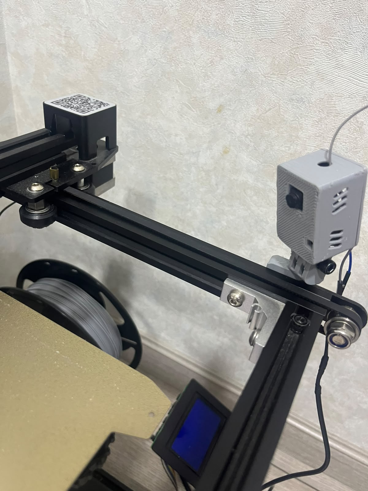
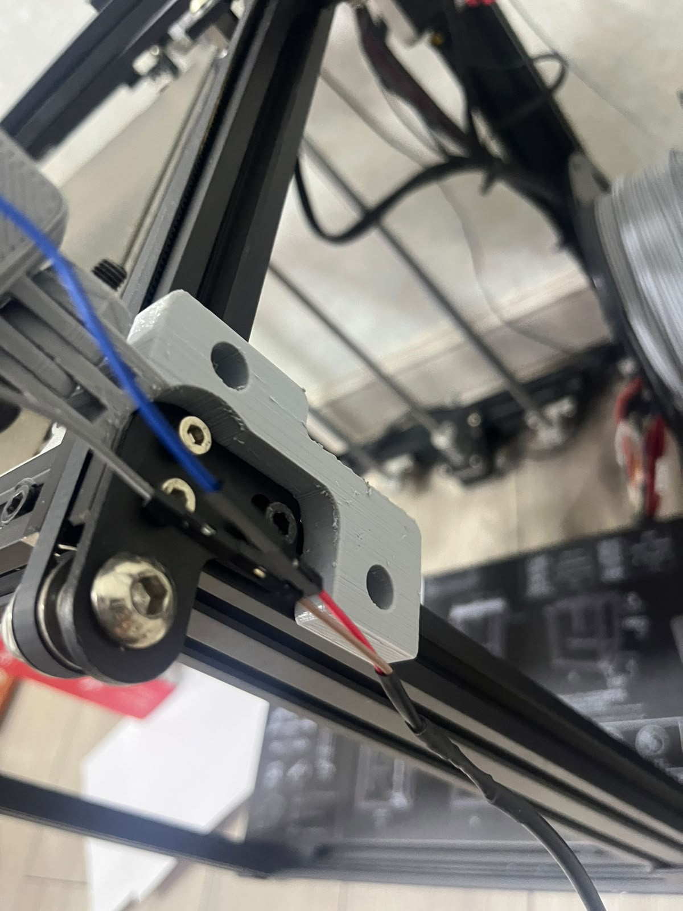
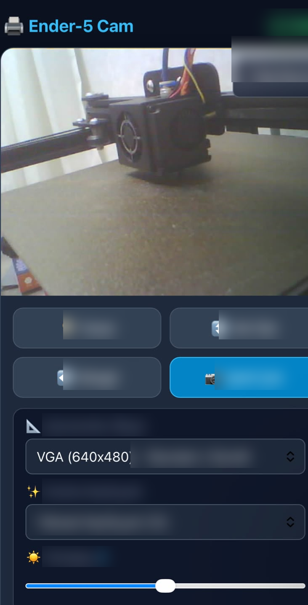

# Ender-5 ESP32-CAM Dual-Server Streamer & Monitor

A high-performance, standalone wireless camera monitoring system tailored for Creality Ender-5 3D printers, powered by the AI-Thinker ESP32-CAM module.

Designed with dual independent HTTP server instances to separate video stream handling from UI control requests, ensuring low latency, smooth video feed, and seamless integration with Klipper (Fluidd / Mainsail), OctoPrint, and Home Assistant.

---

## Visual Showcase

<p align="center">
  
  
</p>

<p align="center">
  
</p>

---

## Key Highlights

- **Dual Server Architecture:**
  - **Port 80:** Modern mobile-responsive dark control dashboard and control REST API.
  - **Port 81:** Dedicated low-latency MJPEG streaming server with non-blocking transmission.
- **Custom Web Dashboard:**
  - Responsive dark UI built for desktop and mobile devices.
  - Live video stream viewer with single-click full-screen mode.
  - Dynamic resolution selector (VGA up to UXGA 2MP).
  - JPEG quality and image brightness sliders.
  - Onboard High-Power Flash LED toggle button.
  - Image vertical flip (`vflip`) and horizontal mirror (`hmirror`) switches.
  - Direct single-frame snapshot capture (`/capture`).
- **Printer Integration Ready:**
  - Works out of the box with Klipper (Fluidd & Mainsail) and OctoPrint camera modules.
- **Networking Stability:**
  - Static IP configuration to prevent IP changes across router reboots.
  - Wi-Fi power saving disabled for uninterrupted monitoring.
  - Brownout detection deactivated during initial boot to safeguard against high inrush currents.

---

## 3D Printed Enclosure & Mounting Bracket

The project includes custom 3D printable brackets designed specifically for the 2020 V-slot aluminum extrusions of the Ender-5 frame.

All files are located in the [`3d_models/`](3d_models/) directory:
- `esp32_cam_case_bottom.stl`: Snug-fit bottom enclosure for the ESP32-CAM board.
- `esp32_cam_case_top.stl`: Ventilated top lid with camera lens and flash cutouts.
- Extrusion bracket mount with swivel pivot for optimal bed angle adjustment.

### Recommended Slicing & Print Settings
- **Filament:** PETG or ABS (recommended due to heated bed ambient temperatures), or PLA+
- **Layer Height:** 0.20 mm
- **Infill:** 30% Gyroid or Grid
- **Perimeters/Walls:** 3 or 4 walls for mechanical durability
- **Hardware Needed:** M3 / M4 T-nuts and matching button-head screws

---

## Hardware Specifications & Pin Configuration

| Component | Specification |
|---|---|
| Microcontroller | ESP32-CAM (AI-Thinker module with OV2640 sensor) |
| Operating Voltage | 5V DC (recommended >= 2A power supply) |
| Flash LED | GPIO 4 |
| Camera Interface | SCCB / DVP parallel 8-bit |

### AI-Thinker Pin Mapping
- **Data Lines:** Y2 (GPIO 5), Y3 (GPIO 18), Y4 (GPIO 19), Y5 (GPIO 21), Y6 (GPIO 36), Y7 (GPIO 39), Y8 (GPIO 34), Y9 (GPIO 35)
- **Clock & Sync:** XCLK (GPIO 0), PCLK (GPIO 22), VSYNC (GPIO 25), HREF (GPIO 23)
- **Control:** SIOD (GPIO 26), SIOC (GPIO 27), PWDN (GPIO 32), RESET (-1)

---

## Getting Started

### 1. Arduino IDE Configuration
1. Install the **esp32 by Espressif Systems** board package in Arduino IDE.
2. Select **AI Thinker ESP32-CAM** under `Tools > Board > ESP32 Arduino`.
3. Configure settings:
   - **CPU Frequency:** 240MHz (WiFi/BT)
   - **Flash Frequency:** 80MHz
   - **Flash Mode:** QIO
   - **Partition Scheme:** Huge APP (3MB No OTA / 1MB SPIFFS)
   - **PSRAM:** Enabled

### 2. Network Configuration
Open `firmware/ender5_cam/ender5_cam.ino` and update your Wi-Fi credentials and static IP to match your local subnet:

```cpp
const char* ssid = "YOUR_WIFI_SSID";
const char* password = "YOUR_WIFI_PASSWORD";

IPAddress local_IP(192, 168, 1, 185);
IPAddress gateway(192, 168, 1, 254);
IPAddress subnet(255, 255, 255, 0);
IPAddress primaryDNS(192, 168, 1, 254);
IPAddress secondaryDNS(8, 8, 8, 8);
```

### 3. Flash to ESP32-CAM
- Connect an FTDI USB-to-TTL programmer:
  - `VCC (5V)` -> ESP32-CAM `5V`
  - `GND` -> ESP32-CAM `GND`
  - `TX` -> ESP32-CAM `U0R` (RX)
  - `RX` -> ESP32-CAM `U0T` (TX)
  - Connect `GPIO 0` to `GND` during flashing to enter bootloader mode.
- Hit **Upload** in Arduino IDE. Once complete, disconnect `GPIO 0` from `GND` and press the reset button.

---

## Klipper & OctoPrint Setup

### Mainsail / Fluidd Configuration
Add a new camera under **Settings > Webcams**:
- **Stream URL:** `http://<ESP32_IP>:81/stream`
- **Snapshot URL:** `http://<ESP32_IP>/capture`
- **Service:** Adaptive MJPEG

### OctoPrint Configuration
Under **Settings > Webcam & Timelapse**:
- **Stream URL:** `http://<ESP32_IP>:81/stream`
- **Snapshot URL:** `http://<ESP32_IP>/capture`

---

## API Endpoints

| Endpoint | Method | Description |
|---|---|---|
| `/` | GET | Serves the main dark-themed web control interface |
| `:81/stream` | GET | Real-time MJPEG video stream |
| `/capture` | GET | Captures and returns a single JPEG snapshot |
| `/toggle-flash` | GET | Toggles the onboard white high-power flash LED |
| `/vflip` | GET | Toggles vertical orientation flip |
| `/hmirror` | GET | Toggles horizontal mirror |
| `/control?var=...&val=...` | GET | Adjusts sensor variables (`framesize`, `quality`, `brightness`) |

---

## License

This project is released under open-source terms. Feel free to use, modify, and distribute for personal and educational 3D printing projects.
